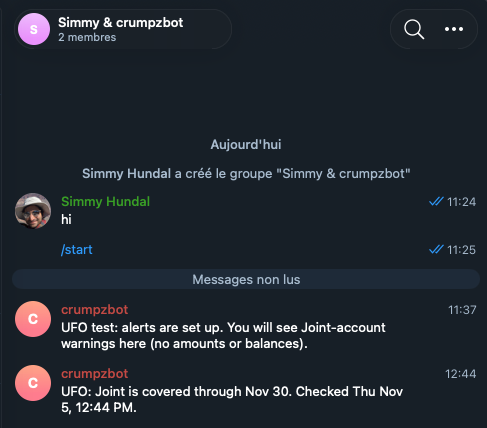

# UFO (Ur Family Office): the Joint account alert bot

**What it is.** UFO is a small tool Simmy built for the two of us. Its job is to warn us *before* the Joint account runs low, and to say what to do about it, so nobody has to ask "do we have enough for the card?".
Every Monday morning it checks Joint against upcoming card payments and posts one short note in our private Telegram group, from a bot called crumpzbot. Here is what that looks like:

If Joint may run short, the note says so, with a date, and tells us to check the bank app. UFO only reads and reports. It cannot move money.

## What the messages say
Telegram group chats are **not end-to-end encrypted** (Telegram can technically read them), so the messages are deliberately thin. Each chat gets one of two levels:

- **Minimal:** a status and a date. No balances, no amounts, no account numbers, no bill names.
  Example: "Joint is covered through Nov 30" or "Joint may run short before Nov 19, please check your bank app".
- **Headroom** (what our group uses): the same, plus our agreed cushion and the lowest the account will get, **rounded down to the nearest $500**,
  e.g. "At its lowest it stays above $3,000 (your cushion is $1,500)". You can check that against the bank app yourself.
  Still no exact balance, bill amounts, account numbers or bank names.
- Exact numbers are never sent over Telegram. If you want to see them, that belongs in a private page, not a chat.

Every message also says when it was checked ("Checked Mon Nov 9, 8:00 AM"), so you can tell it is fresh. A "Joint is covered" note arrives every Monday even when all is well, so a quiet week is never ambiguous.

## Can anyone add the bot and get these notifications?
**No.** A bot's name is public, so anyone can find it and message it, or add it to their own group. That gets them nothing:

- The bot only posts to the chat IDs saved in a private file on Simmy's computer. Our group is the only place it posts.
- The program never listens. It has no way to read messages or reply, so a stranger who messages the bot gets silence.
- People only see our alerts if they are **members of our group**. So keep the group private: no public invite link, and check
  the member list now and then.

## What the bot can and cannot do
| | |
|---|---|
| Post a message in our group | Yes, that is all it does |
| Read what we write in the group | **No** (it is switched to send-only; Telegram's "privacy mode" is on) |
| Answer questions or give out information | **No**, nothing listens |
| Touch the bank accounts | **No**. It has no bank access at all. Only the program on Simmy's computer talks to the bank, through Plaid, **read-only** |
| Move money | **No**, and nothing in UFO can. Plaid is only asked for read access (balances and statements) |

## The bank connection
- The Chase username and password are typed into Chase's own login page; UFO and the bot never see them.
- The connection is read-only and can be removed at any time (in UFO, or from Chase's data-sharing settings).
- The access token and the Telegram bot token live in files on Simmy's computer that only Simmy's user can read. They are not in GitHub
  (the code is in a private repository and those files are excluded).
- UFO runs no server: it wakes up on a schedule, checks, posts, and exits. Nothing is open to the internet.

## What could actually go wrong, and how bad it would be
| If this happened... | What an attacker gets | What to do |
|---|---|---|
| Someone takes over a Telegram account in the group | Our old alerts (which contain no exact amounts) | Turn on Telegram **Two-Step Verification**; remove the person from the group |
| The bot token is stolen | They could post **fake** alerts in our group. They could not read the group or touch the bank | Revoke the token in @BotFather (`/revoke`) and re-run setup |
| Simmy's computer is compromised | The read-only bank connection and the bot token | Remove the bank connection, revoke the bot token, change passwords |
| Telegram itself is breached | Message history (no exact amounts, by design) | Nothing sensitive is in it |

## How we keep it honest
- The rule "no exact amounts over Telegram" is enforced by automated tests, not just intention.
- The bot is checked to be send-only, and anything it is not allowed to do raises an error.
- You can always verify with your own eyes: you are on the Joint account too, so the bank app is the source of truth.

**What is not zero-risk:** any messaging app on a phone can be lost or taken over, and this tool depends on one computer staying secure.
We have tried to make sure that none of those risks can reach the money: the worst realistic outcome is a fake or leaked *status message*, not a transfer.
Alerts are information, not financial advice.
